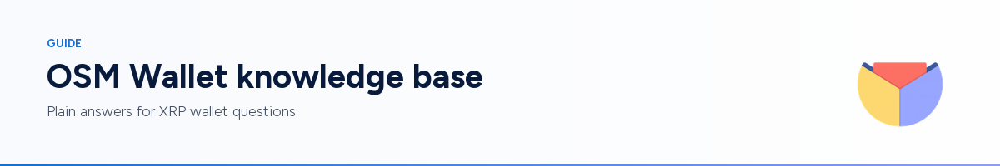

  

# How an XRP wallet holds your funds

An XRP wallet does not store coins. It stores the key that controls an account on the XRP Ledger, and the XRP itself lives in the ledger's record of that account. OSM Wallet holds that key for you, shows the account it controls, and submits the transactions you approve. Understanding this explains most of what looks strange about a wallet: the reserve, the trustlines, and why a restore needs a phrase rather than a file.

## Where your XRP actually lives

Your XRP is a balance recorded against an address on the XRP Ledger, a public network that every XRP wallet reads and writes. The wallet is a viewer and a signer: it reads the account's balance from the ledger and holds the key that can change it. Delete the wallet and the account still exists; lose the key and the account still exists but nobody can move it.

That is why a wallet restore is an import rather than a download. There is nothing to download - the account never left the network. What you restore is the ability to sign, which comes from the key your recovery phrase encodes.

## Keys, addresses and phrases

Three things get confused constantly, and the difference matters when something goes wrong. An address is public and safe to share; it is what people send XRP to. A key is private and controls the account. A recovery phrase is a human-writable encoding of the key, long enough to be backed up on paper, short enough to type once.

| Element | What it is | Safe to share | What happens if lost |
|---|---|---|---|
| Address | The account identifier, starts with an r | Yes, it is how you get paid | Nothing - it is derived from the key |
| Private key | The secret that authorises transactions | Never | The account is unusable |
| Recovery phrase | A written form of the key | Never | The account cannot be restored |
| Password or PIN | A local lock on the app | Never | Access to the app, not to the funds |

Note the last row. A wallet password protects the app on that machine; it is not the account. Reinstalling and importing with the phrase restores access even if the password is gone, which is why the phrase is the only backup that counts.

## The reserve: why the balance and the spendable amount differ

Every XRP Ledger account must hold a base reserve, so an account holding a small balance cannot send all of it. The reserve is not a fee and it is not held by the wallet; it is a ledger requirement that keeps the account existing. An account also needs additional reserve for each object it owns, such as a trustline.

This is the single most common source of confusion for a new XRP holder: the wallet shows XRP, the send screen refuses an amount, and the difference is the reserve plus any reserve held for trustlines. The mechanics are covered in [The XRP reserve, explained without the confusion](https://github.com/osmwallet/troubleshooting-hub/blob/HEAD/xrp-reserve-explained-osmwallet.md); the practical fix when a transfer will not go through is in [Sending your full XRP balance](https://github.com/osmwallet/troubleshooting-hub/blob/HEAD/send-max-xrp-balance-osmwallet.md).

## What a trustline adds to an account

XRP needs no permission to hold. Any other asset on the XRP Ledger - an issued token, a stablecoin - requires the account to create a trustline to that issuer first, and each trustline adds to the reserve the account must maintain. A wallet that receives a token without a trustline cannot display it as a balance, because the ledger has no record that the account accepts it.

This is also why importing a seed elsewhere can look like tokens disappeared: the account came across, but the trustlines and their reserve belong to the account on the ledger, not to the app you are using. The full explanation is in *Issued tokens and TrustLines in practice*.

## How OSM Wallet holds an account

OSM Wallet is a non-custodial wallet for the XRP Ledger, available as a desktop app for Windows, macOS and Linux and as a browser extension. It creates and imports accounts, displays the balance the ledger reports, sends and receives XRP and issued tokens, manages trustlines, and handles account deletion with reserve recovery. Your keys stay with you; the wallet's job is to show the account accurately and submit what you approve.

The onboarding puts the recovery phrase first, before the account is funded, because an account whose backup has never been tested is an account one accident away from being lost. When you create an account, write the phrase down in order and confirm it in the app.

The wallet is actively maintained, and the current release is available from the GitHub releases page.

## What this means when something looks wrong

A balance that will not move, a token that does not appear, a restored account with an unexpected reserve - all three follow from the model above rather than from a fault in the app. Check the reserve, check the trustlines, and check that the account you restored is the account you funded. If the wallet shows zero available XRP, [Why the wallet shows zero available XRP](https://github.com/osmwallet/troubleshooting-hub/blob/HEAD/why-osmwallet-shows-zero-available-xrp.md) walks through the causes in order.

If you are choosing between a key on your computer and a key on a device that never connects, *What is a cold wallet for XRP?* explains the difference, and *What a non-custodial wallet actually means* covers who can move the funds in each case. For protecting the phrase itself, *Protecting a seed phrase you cannot reset* is the place to start.

### FAQ

### Does the wallet contain my XRP?

No. The XRP is recorded on the XRP Ledger against your address. The wallet contains the key that controls the account, which is why the balance is identical whichever compatible app you use to open it.

### Can I restore my wallet with the address instead of the phrase?

No. An address identifies an account but cannot authorise anything. Restoring access needs the recovery phrase; anybody who tells you an address alone can recover funds is describing something that does not exist.

### Why can I not send my whole balance?

Because the account must keep its base reserve, and any additional reserve for objects such as trustlines. The amount the ledger will let you send is the balance minus that reserve, minus the transaction fee.

### What happens to my XRP if OSM Wallet stops being updated?

Your account lives on the XRP Ledger, not inside the app, so the funds remain accessible through any compatible wallet that accepts your recovery phrase. This wallet is actively maintained and updated; the point is that your access does not depend on that.
